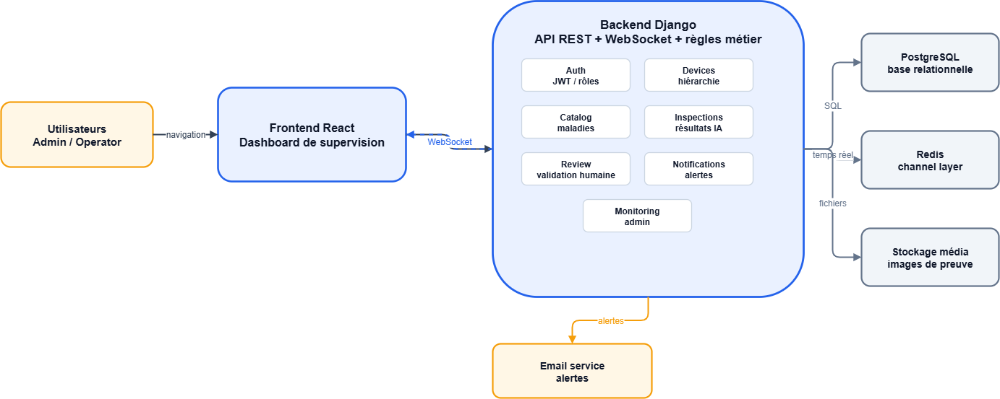
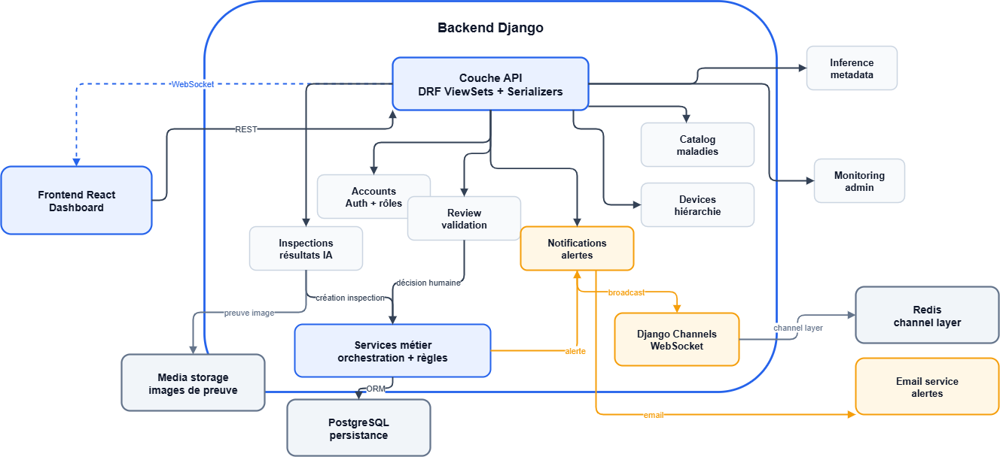
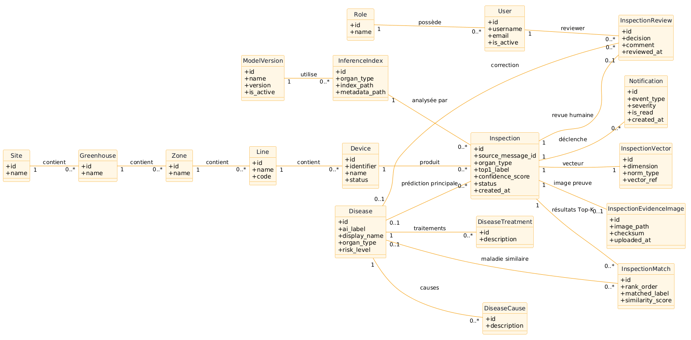

# Inspection Monitoring Dashboard

**A full-stack inspection monitoring and human-review web application built with Django REST Framework and React.**

This repository presents the **web application layer** of my larger [Edge AI & IoT visual monitoring project](https://github.com/medbaihich/projet-tomate-monitoring). It focuses on the backend APIs, relational data management, inspection workflows, monitoring dashboards, and review interfaces rather than the camera hardware or model-execution pipeline.

The frontend and backend were designed as separate components of the larger system. During development, I tested web workflows independently of the camera and AI services, using **Postman** to submit API requests and exercise backend behavior. This is a case study extracted from that same engineering project, **not a second client engagement**.

## What the application does

The application provides an interface for supervising inspections and handling results generated elsewhere in a monitoring system. Its responsibilities include:

- **Inspection management:** store inspection records, associated devices, predicted labels, confidence scores, processing status, and related matches.
- **API-based result ingestion:** validate incoming result payloads and handle repeated messages using a source message identifier.
- **Human review:** let authorized users inspect results, record review decisions, and maintain review history.
- **Monitoring dashboard:** present inspection activity, device information, alerts, charts, and a map-based view of relevant signals.
- **Device and location management:** organize sites, greenhouses, zones, lines, and connected devices.
- **User access:** JWT-based authentication, user accounts, roles, and protected application routes.
- **Notifications:** backend notification records and WebSocket updates through Django Channels and Redis, with optional email-notification components.
- **Evidence images:** backend endpoints and records for inspection-related image evidence where the relevant workflow is configured.

The interface and domain data reflect the original **tomato-monitoring use case**. This repository does not claim to provide a generic, production-ready inspection platform for every industry.

## Technology stack

| Layer | Technologies |
| --- | --- |
| Backend | Python, Django 5.2, Django REST Framework |
| Frontend | React, Vite, Material UI, TanStack Query, Zustand |
| Database | PostgreSQL |
| Authentication | Django authentication, JWT / Simple JWT |
| Real-time communication | Django Channels, Redis, WebSockets |
| Visualization | Recharts, Leaflet |
| Integration and testing | REST APIs, JSON, Postman (development testing), Django tests, frontend regression tests |
| Container configuration | Docker and Docker Compose (see limitations below) |

## Architecture

The application separates the user interface, API and business logic, persistence, and real-time communication:

1. The **React dashboard** displays data and sends requests to the Django REST API.
2. **Django REST Framework** handles authentication, validation, inspection records, device information, review actions, and monitoring endpoints.
3. **PostgreSQL** stores application data and relationships.
4. **Django Channels and Redis** support notification events and dashboard refreshes over WebSockets.
5. External image-processing components can submit completed results to a dedicated ingestion endpoint. The web application does **not** need to run model inference itself to accept a valid result payload.

### System overview



### Django backend architecture



### Data model



The diagrams document the project's architecture and domain relationships. The source code in `backend/apps/` is the reference for exact model fields, endpoints, and behavior.

## Repository structure

```text
inspection-monitoring-dashboard/
├── backend/
│   ├── apps/
│   │   ├── accounts/        # Users, authentication, permissions
│   │   ├── catalog/         # Disease catalog and supporting data
│   │   ├── core/            # Shared utilities and demo-data command
│   │   ├── devices/         # Sites, locations, and devices
│   │   ├── inference/       # Model and index metadata
│   │   ├── inspections/     # Inspection records, validation, ingestion
│   │   ├── monitoring/      # Monitoring and activity endpoints
│   │   ├── notifications/   # Notifications and WebSocket consumer
│   │   ├── review/          # Human-review workflow
│   │   └── vectors/         # Embedding-related data models
│   ├── config/              # Django settings, URLs, ASGI
│   ├── requirements.txt
│   └── manage.py
├── frontend/
│   ├── src/
│   │   ├── api/             # API client
│   │   ├── features/        # Dashboard, inspections, review, etc.
│   │   ├── layouts/
│   │   └── store/           # Authentication state
│   └── package.json
├── docs/                     # Architecture diagrams
├── .env.example
└── docker-compose.yaml
```

## Selected API endpoints

These routes are implemented in the Django URL configuration. Some require a user JWT; the result-ingestion and evidence-upload endpoints use their own configured bearer tokens.

| Method | Endpoint | Purpose |
| --- | --- | --- |
| `GET` | `/api/v1/health/` | Health check |
| `GET` | `/api/v1/schema/` | OpenAPI schema |
| `POST` | `/api/v1/auth/login/` | Obtain authentication tokens |
| `POST` | `/api/v1/auth/refresh/` | Refresh an access token |
| `GET` | `/api/v1/auth/me/` | Current user |
| `GET` | `/api/v1/devices/devices/` | List registered devices |
| `GET` | `/api/v1/inspections/inspections/` | List inspection records |
| `POST` | `/api/v1/inspections/ingest-ai-result/` | Ingest an external processing result |
| `GET` / `POST` | `/api/v1/review/reviews/` | View or create human reviews |
| `GET` | `/api/v1/notifications/` | List notifications |
| `GET` | `/api/v1/monitoring/summary/` | Administrative monitoring summary |
| WebSocket | `/ws/notifications/` | Real-time notification events |

Additional routes for sites, greenhouses, zones, lines, catalogs, inspection matches, and evidence images are defined in `backend/config/urls.py` and the individual application URL modules.

## Local development and testing

### Prerequisites

- Python 3.12 and a Python virtual environment
- A compatible Node.js/npm installation for the frontend dependencies
- PostgreSQL
- Redis for the Channels/WebSocket functionality

### 1. Clone the repository

```bash
git clone https://github.com/medbaihich/inspection-monitoring-dashboard.git
cd inspection-monitoring-dashboard
```

### 2. Configure and start the backend

Create a PostgreSQL database and user for local development, then configure the connection in `backend/.env`:

```bash
cd backend
python -m venv .venv
# Activate the virtual environment using the command for your OS.
python -m pip install -r requirements.txt
cp .env.example .env
```

Set local values in `backend/.env`, including:

```dotenv
DJANGO_SECRET_KEY=replace-with-a-local-secret
DJANGO_DEBUG=True
DJANGO_ALLOWED_HOSTS=127.0.0.1,localhost
POSTGRES_DB=backend
POSTGRES_USER=postgres
POSTGRES_PASSWORD=replace-with-your-local-database-password
POSTGRES_HOST=127.0.0.1
POSTGRES_PORT=5432
REDIS_URL=redis://127.0.0.1:6379/0
AI_WORKER_INGESTION_TOKEN=replace-with-a-local-test-token
EVIDENCE_IMAGE_UPLOAD_TOKEN=replace-with-a-different-local-test-token
EVIDENCE_IMAGE_COMMANDS_ENABLED=False
EMAIL_NOTIFICATIONS_ENABLED=False
EMAIL_BACKEND=django.core.mail.backends.console.EmailBackend
```

Use your own credentials and keep `.env` out of version control. The database and Redis services must be running before the dependent functionality can work.

Then run:

```bash
python manage.py migrate
python manage.py check
# ASGI server for HTTP and WebSocket routes:
daphne -b 127.0.0.1 -p 8000 config.asgi:application
```

With the backend running, an initial API check is:

```bash
curl http://127.0.0.1:8000/api/v1/health/
# Expected response: {"status":"ok"}
```

**Demo data:** The project includes `python manage.py seed_demo_data`. This command creates a demonstration administrator with a fixed development password and model/index metadata referencing assets from the larger project. Run it **only in an isolated local environment**, change the demo account password immediately (`python manage.py changepassword admin`), and never expose those credentials or treat the referenced AI assets as included in this repository.

### 3. Start the frontend

In a separate terminal, from the repository root:

```bash
cd frontend
npm ci
npm run dev
```

Vite is configured to serve the frontend on port **3000**. The frontend sends `/api/v1/...` requests using **same-origin paths** and connects to the WebSocket endpoint. To use the full browser application, configure a reverse proxy that routes `/api/` to the Django backend, `/ws/` to the ASGI/WebSocket backend, and frontend paths to Vite. **The current Vite configuration does not provide an API proxy by itself.** Running the two development servers separately without appropriate routing does not constitute a complete frontend/backend setup.

### 4. Test the components

Backend (requires a suitable local PostgreSQL test database and permissions):

```bash
cd backend
python manage.py test
```

Frontend:

```bash
cd frontend
npm test
npm run lint
npm run build
```

The repository contains Django tests and frontend regression checks. **These commands are provided as development/test entry points; a fresh end-to-end run of this extracted repository has not been independently verified in this README.**

## Current Docker Compose limitation

`docker-compose.yaml` was inherited from the **larger Edge AI & IoT system**. It still defines an `ai_worker` build using `./ai_assets` and references that directory from the backend service. The `ai_assets` directory is **not included** in this extracted repository.

Consequently, **`docker compose up --build` should not be presented as a verified, one-command standalone setup for this repository**. A web-only Compose configuration would need to remove or replace those references and retain the services and routing required by the web application.

This packaging limitation is separate from the development history: I previously exercised frontend and backend web workflows independently of the camera/AI pipeline using Postman and frontend checks. I am not claiming that the published extracted Compose stack has been rebuilt and verified end to end.

## Scope and boundaries

**Included here:** Django backend APIs, React frontend, PostgreSQL models and migrations, authentication, inspection/review logic, monitoring views, notifications, and supporting tests.

**Not included as working implementations in this repository:** the camera/edge runtime, model training, AI worker service, and the AI assets referenced by the original full-system configuration. Some optional actions, such as requesting new evidence images from a device, still rely on external components and configuration.

This repository is an **engineering case study**, not a claim of commercial deployment, production security certification, or a second independent client project. Use synthetic or authorized demonstration data when showing screenshots or API examples.

## Original project

The complete system context—including the edge and AI components—can be found here:

**[Edge AI & IoT Visual Monitoring System](https://github.com/medbaihich/projet-tomate-monitoring)**
